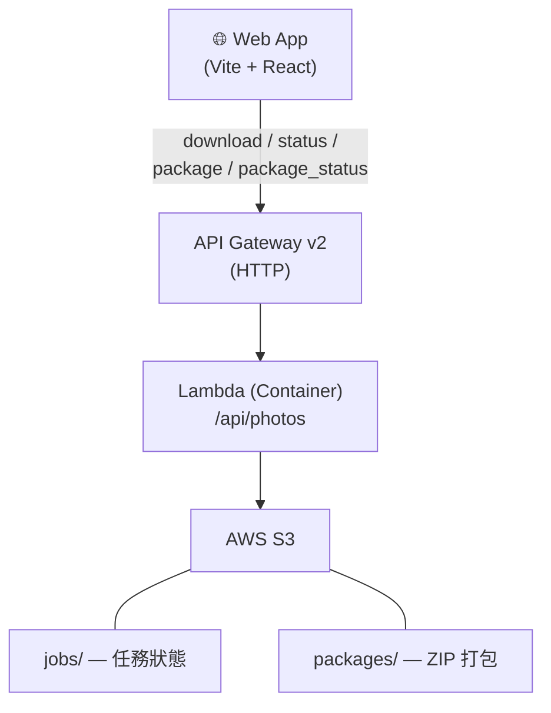

# Naver Blog Image Downloader

輸入 Naver Blog 網址，自動擷取並批次下載文章中的所有照片。前端為免安裝的 Web App，後端採用 AWS Lambda + API Gateway v2 + 非同步 Polling 架構。

## 系統架構



## 為何採非同步 Polling

Lambda 執行 Playwright 爬蟲時間常超過 API Gateway 29 秒硬限制，因此改為三段式流程：

1. **Submit**：Web `POST /api/photos` 帶 `action: "download"` + `blog_url`，Lambda 立即建立 S3 job → HTTP 202 + `job_id`
2. **背景執行**：Lambda 以 `_async_worker` 自呼叫，Playwright 抓圖、結果寫入 S3
3. **Polling**：Web 每 3 秒一次 `POST /api/photos` 帶 `action: "status"` + `job_id`，最多 10 分鐘；完成時取回 `image_urls` 清單

## Monorepo 結構

```text
apps/backend/  — Python AWS Lambda backend（詳見 apps/backend/README.md）
apps/web/      — Vite + React 19 + TypeScript Web app（含 landing 頁與 Web SPA，詳見 apps/web/CLAUDE.md）
openspec/      — Spectra SDD specs 與 change proposals
```

> 行動版 App（Flutter iOS/Android）已於 2026-08-31 停止維護並自 repo 移除。
> 最後一版程式碼與規格保存在 `mobile-v1.6.1` tag，可用
> `git checkout mobile-v1.6.1 -- apps/mobile openspec/specs` 取回。

## 快速開始

```bash
# Backend
cd apps/backend
uv sync
make deploy   # 建 image → 推 ECR → 更新 Lambda

# Web
cd apps/web
pnpm install
pnpm dev      # 開發伺服器 http://localhost:5173
```

各元件的完整設定、部署流程與細節請參閱：

- [`apps/backend/README.md`](apps/backend/README.md)
- [`apps/web/CLAUDE.md`](apps/web/CLAUDE.md)

## 技術棧速覽

| 元件    | 技術棧                                                   | 部署                         |
| ------- | -------------------------------------------------------- | ---------------------------- |
| Backend | Python 3.10+ + Playwright + uv + Docker                  | AWS Lambda (Container) + ECR |
| Web     | Vite + React 19 + React Router v7 + Zustand + Tailwind 4 | GitHub Pages（靜態檔）       |

## 版號管理與發布流程

各元件獨立管理 semver，CD workflow 依 version 檔案產生對應 tag 與 GitHub Release：

| 元件    | Version 檔案                  | Tag 格式             | 未 bump 時的 CD 行為 |
| ------- | ----------------------------- | -------------------- | -------------------- |
| backend | `apps/backend/pyproject.toml` | `backend-v<version>` | Fail                 |
| web     | `apps/web/package.json`       | `web-v<version>`     | Skip（notice）       |

`<version>` 為 semver 三段。每次發版前須先 bump 對應元件的 version 檔案。

## CI/CD（GitHub Actions）

各元件皆有獨立的 CI/CD workflow，CI 成功後自動觸發 CD。Release Notes 與 PR 審查統一透過 [LKAIKit](https://github.com/leoho0722/LKAIKit) 的 `lkai` CLI 呼叫 AI（供應商與模型設定於 `.github/lkai.json`：PR 審查使用 `review` 設定，目前為 Anthropic `claude-opus-5-5`；Release Notes 使用 `default` 設定，目前為 `claude-sonnet-5-5`；`lkai` 只能在 macOS runner 執行），生成正體中文內容，Release Notes 在 AI 失敗時 fallback 至原始 commit log。

| Workflow | 觸發條件 | 說明 |
|----------|----------|------|
| Backend CI | `apps/backend/**` 變動 | Ruff lint + format 檢查 |
| Backend CD | Backend CI 成功 | Docker build → ECR push → Lambda 更新 → git tag + Release |
| Web CI | `apps/web/**` 變動 | TypeScript 檢查 + Vitest 測試 + Vite build + Prettier 格式檢查 |
| Web CD | Web CI 成功 | 建立 git tag + GitHub Release（僅版號管理，不部署） |
| PR AI Review | PR 開啟／更新 | 以 LKAIKit 審查 PR diff，以一次 PR review 發布正體中文審查意見：總評放在本文，問題以 inline comment 標在程式碼行上（詳見下方說明） |
| Deploy Pages | `apps/web/**` 變動 | Build web app（含 landing 頁與 SPA） → 產出 `apps/web/dist/` → 複製為 Pages artifact（附 404.html SPA fallback）→ 部署至 GitHub Pages |

### PR AI Review 的運作方式

- **排除自動產生的檔案**：依 PR base commit 的 `.gitattributes` 中標記為 `linguist-generated` 的路徑（Spectra 產生的 skill、archify 輸出、lockfile）略過，只列在 review 的「已略過」清單；在 PR 中修改 `.gitattributes` 對該 PR 本身不生效。已刪除與二進位的檔案也只列出、不審查內容。
- **依相關性分段並全部審查**：剩下的 patch 超過每段 6000 行時，依元件區域與功能分段（原始碼與對應的測試放在同一段），每段都會送審，一次最多同時送出 3 段；超過 6 段時照樣全部審查，但會提醒可以拆小 PR。多段時最後再彙整成一份總評。
- **以一次 PR review 發布，依嚴重程度決定是否擋合併**：
  - 🔴 阻擋合併與 🟡 建議修正：能對應到 diff 行的以 inline comment 標在該行，對應不到行的改發檔案層級留言（不指定行號、標在檔案上）。兩者都會形成討論串，main 要求所有對話 resolve 才能合併，所以修正或由人確認之前會擋住合併。
  - 🟢 可選優化：只列在 review 本文，不開討論串、不擋合併。
  - 整體結論由程式依意見與仍未 resolve 的上一輪 AI 討論串計算，與會不會擋合併一致：有 🔴 為「有阻擋合併的問題」，有 🟡 為「有建議修正的問題」，只剩 🟢 為「沒有擋合併的問題」。
- **AI 確認已修正才收掉討論串**：push 新 commit 重新審查時，會把還沒 resolve 的 AI 討論串交給新一輪的 AI 判斷問題是否已修正。確認已修正的討論串會附上一則說明回覆並標為 resolved；還沒修正的維持未 resolve（繼續擋合併），新一輪也不會重複提出同一個問題。檔案的改動被還原或檔案被刪除時，上面的 AI 討論串會直接收掉；之前留下的 🟢 討論串也會附上說明後收掉。送審失敗、被截斷、自動產生或二進位檔案上的討論串維持不動，需要時手動 resolve；由人開啟的討論串不會被動到。
- **失敗判定**：任一段送審失敗或回答無法解讀時，仍會發布已取得的內容，但 workflow 判定為失敗；意見的嚴重程度不影響 workflow 結果。

## 開發規範與共用準則

所有跨元件的開發準則（正體中文註解、Conventional Commits、Spectra SDD 流程）集中於 [CLAUDE.md](CLAUDE.md)。各元件專屬規則在各自 `apps/<name>/CLAUDE.md`。
